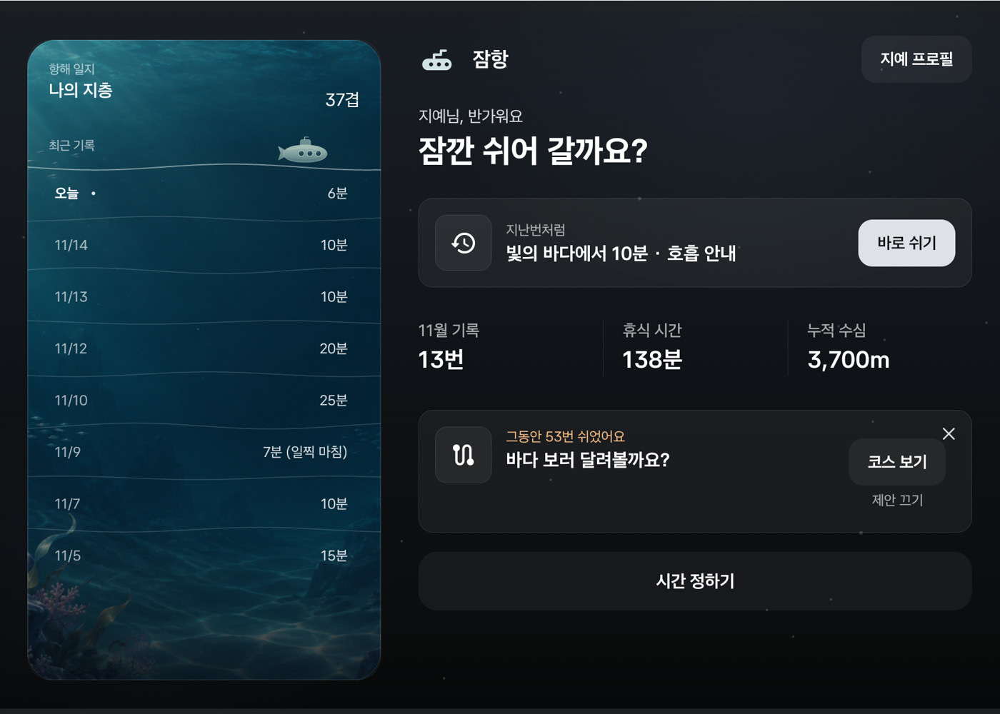
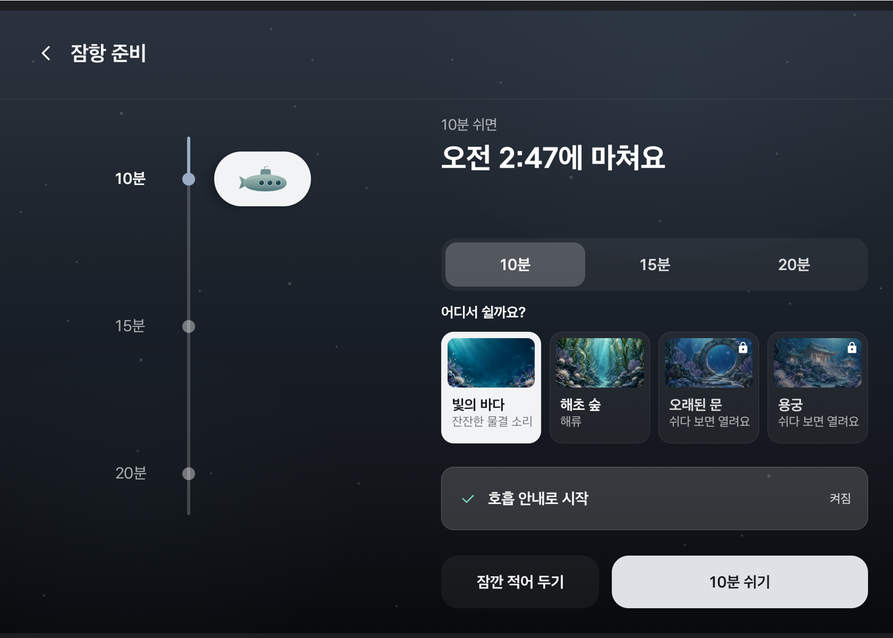
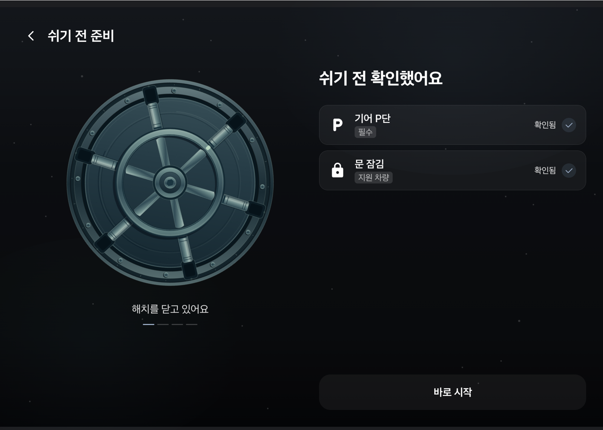
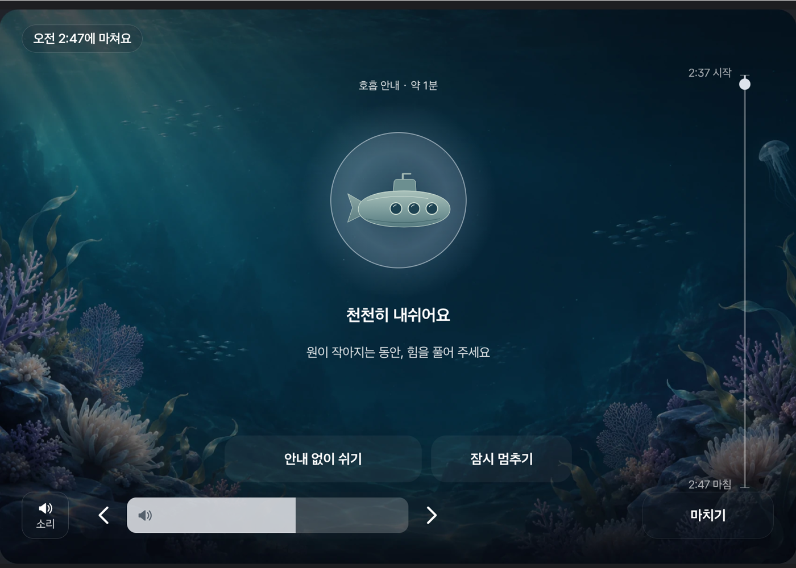
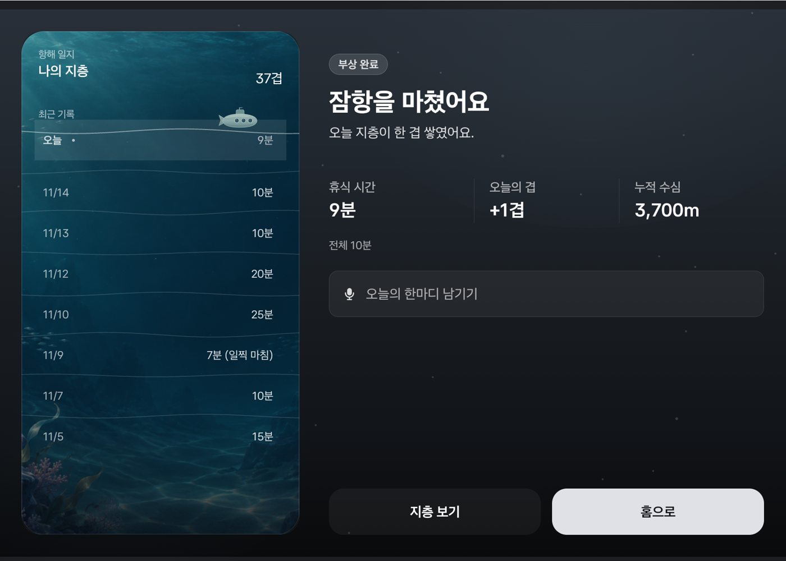

# 잠항 (JAMHANG)

퇴근 후 주차된 차 안의 10~20분을, 집에 들어가기 전 혼자 숨을 고르는 심해 휴식으로 바꿔 주는 Pleos Connect 주차 전용 휴식 앱.



---

## 핵심 기능

### 1. 시작 전 · 시간과 선실 선택

10분·15분·20분 중 휴식 시간을 고르면 남은 시간 대신 **끝나는 시각**을 알려 줍니다. 빛의 바다·해초 숲·오래된 문·용궁 가운데 선실을 고르고, 원하면 호흡 안내와 '차에 두고 갈 것' 한 줄을 켜 둡니다. 홈에서는 지난 설정 그대로 **바로 쉬기**를 눌러 빠르게 시작할 수 있습니다.



### 2. 쉬기 전 · 차량 상태 확인

해치가 닫히는 약 3초 동안 Vehicle SDK로 기어 P단을 확인하고, 지원 차량에서는 문 잠김도 함께 확인합니다. 기어를 읽지 못하면 사용자가 직접 P단임을 확인할 수 있으며, 잠항 중 P단을 벗어나면 소리를 멈추고 실제로 쉰 시간만 기록한 뒤 자동으로 마칩니다.



### 3. 잠항 중 · 카운트다운 없는 휴식

쉬는 동안에는 숫자 카운트다운 대신 끝나는 시각과 은은한 진행 게이지만 보여 줍니다. 선실별 바다 소리와 음량을 조절할 수 있고, 호흡 안내를 켜면 약 1분 동안 들숨과 날숨을 안내한 뒤 조용한 휴식으로 이어집니다. 종료 1분 전에는 화면과 음성으로 예고하고 한 번에 5분을 더 쉴 수 있습니다.



### 4. 부상 · 하루 한 겹 쌓이는 기록

실제로 5분 이상 쉰 날에는 하루 한 번 지층 한 겹과 수심 100m가 쌓입니다. 같은 날 두 번째 휴식과 일찍 마친 휴식도 항해 일지에 남고, 한 줄 메모는 키보드나 Pleos SpeechToText로 입력할 수 있습니다. 음성 원본과 위치·주행 기록은 저장하지 않으며, 게스트는 기록 없이 쉴 수 있습니다.



---

## 실행 방법

### 요구 사항

- Android Studio (JDK 17, Android Studio 내장 JBR 사용 가능)
- Pleos Connect Emulator (Android Automotive, API 34) AVD — [설치 가이드](https://document.pleos.ai/en/docs/connect/guide/getting-started/application-development/setup-connect-sdk-emulator)
- Pleos SDK는 `settings.gradle.kts`에 등록된 Pleos Maven 저장소에서 자동으로 받습니다. 별도 키는 필요 없습니다.

### 빌드·설치

```bash
# Android Studio의 JBR을 쓰는 경우
export JAVA_HOME="/Applications/Android Studio.app/Contents/jbr/Contents/Home"

./gradlew installDebug       # 실행 중인 에뮬레이터에 설치
./gradlew assembleDebug      # 디버그 APK 빌드
```
또는 Android Studio에서 프로젝트를 열고 Pleos Connect AVD를 선택해 Run 합니다. 이 앱은 Android Automotive 전용이므로 일반 스마트폰 AVD에는 설치 대상이 표시되지 않을 수 있습니다.

### 처음 실행할 때 권한

앱이 알림 권한을 요청합니다. 허용하면 화면이 꺼지거나 다른 앱이 앞에 와도 Foreground Service가 끝나는 시각과 바다 소리를 유지합니다.

기어·도어·충전 상태, 내비, 음성 입력은 Pleos Connect가 제공하는 차량 권한을 사용합니다. 해당 기능을 지원하지 않거나 신호를 읽지 못해도 시간 선택 → 휴식 → 기록의 기본 흐름은 동작합니다.

---

## 테스트 환경·설정

| 항목 | 내용 |
|---|---|
| 플랫폼 | Pleos Connect (Android Automotive OS), minSdk 28 / targetSdk 34 |
| 언어·UI | Kotlin, Jetpack Compose |
| SDK | Pleos Vehicle SDK 2.3.2, NaviHelper SDK 3.0.5, SpeechToText SDK 3.3.1 |
| 검증 환경 | Pleos Connect Emulator v2.1.0 (API 34), macOS |
| 빌드 환경 | JDK 17, Gradle 9.9, Android Gradle Plugin 9.5.1, Kotlin 2.2.10 |
| 검증 방식 | 내장 시연 도구를 이용한 수동 시나리오 테스트, `./gradlew assembleDebug` 빌드 확인 |

### 에뮬레이터에서 핵심 흐름 시연하기

1. 홈에서 **시간 정하기 → 10분 쉬기**를 누르면 P단·문 잠김 확인 후 잠항이 시작됩니다.
2. 홈의 잠항 로고를 길게 누르거나 잠항 중 끝나는 시각 칩을 길게 누르면 **상황을 바꿔서 확인하기**가 열립니다.
3. 시연 도구에서 실제 차량 대신 가짜 값을 선택해 기어, 문, 충전 상태, 배터리, 주행 규제와 내비 연결을 바꿀 수 있습니다.
4. 잠항 중 **종료 1분 전으로 건너뛰기**를 누르면 1분 전 예고 → 5분 연장 또는 마치기 → 지층 적립 흐름을 바로 확인할 수 있습니다.

- 기어를 `DRIVE`로 바꾸면 자동 부상 결과가 나타납니다.
- 운전석 문을 열면 소리를 멈추고, 문을 닫은 뒤 사용자가 직접 이어서 쉬도록 묻습니다.
- 전화 수신·종료, 다른 미디어 재생, 기록 저장 동의·게스트, 프로필 이름도 시연 도구에서 바꿀 수 있습니다.
- 실차 확인이 필요한 항목은 기어·도어 신호, 온디바이스 음성 인식, 내비 목적지 전달입니다.

---

## APK 위치

| 파일 | 설명 |
|---|---|
| `app/build/outputs/apk/debug/app-debug.apk` | `./gradlew assembleDebug` 빌드 결과 (versionName 1.0) |

```bash
adb install -r app/build/outputs/apk/debug/app-debug.apk
```

`build/` 디렉터리는 Git 추적 대상에서 제외되어 있으므로 저장소를 새로 받은 뒤에는 APK를 다시 빌드해야 합니다.

---

## 참고

- 1분 전 예고와 호흡 안내에는 미리 합성한 AI 음성을 사용합니다. 자세한 표기는 [`docs/NOTICE.md`](docs/NOTICE.md)에 있습니다.
- 전체 흐름은 [`demo/jamhang_demo.mp4`](demo/jamhang_demo.mp4)에서 확인할 수 있습니다.
